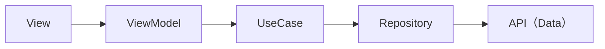

# friend-search for Android


ゲームを一緒に遊ぶ相手を探すアプリの Android 版です。
ゲームを選んで募集を投稿し、新着一覧・ゲームでの絞り込み・自然文の AI 検索で相手を探せます。
iOS 版も、同じ機能と同じ層構成で作っています。

> [!NOTE]
> デモ用のアプリです。新規登録・パスワード再設定の機能はなく、あらかじめ用意したアカウントでログインします。

## 主な機能

| 画面 | できること |
| --- | --- |
| ログイン | 用意済みのアカウント（メールアドレスとパスワード）でログイン |
| 表示名の設定 | 初回だけ表示名（2〜24文字）を決める |
| 探す | 全ゲームの新着一覧、ゲームでの絞り込み、自然文の AI 検索（意味が近い募集を関連度順に表示） |
| 投稿 | ゲーム・本文・VC ツール（Discord / LINE / ゲーム内VC など）・募集人数（1〜10人）・招待リンクを入力して募集 |
| 募集の詳細 | 参加・参加の取り消し・投稿者による募集の終了。招待リンクは投稿者と参加者にだけ表示 |
| マイページ | 表示名と Identicon、自分の募集、参加中の募集、ログアウト |

## 技術スタック

| 分類 | 使っているもの |
| --- | --- |
| 言語・UI | Kotlin 2.2、Jetpack Compose（Material 3）、Navigation 3 |
| 認証 | Amplify Android（aws-auth-cognito + core-kotlin）。Amazon Cognito に SRP でログイン |
| API 通信 | Retrofit 3 + OkHttp + kotlinx.serialization |
| テスト | JUnit 4 + kotlinx-coroutines-test（ユニットテスト）、Compose UI Test（UI テスト） |
| ビルド | Gradle 9.6、Android Gradle Plugin 9.5、compileSdk 37 / minSdk 36 |

## アーキテクチャ



```
app/src/main/java/com/example/friend_search/
├── view/         Compose の画面。Application・Activity（view/root）も View の一部。各画面が自分の ViewModel を作る
├── viewmodel/    画面状態（Compose の State）・入力検証・表示用の値（文言・ラベル・候補検索・Identicon）
├── usecase/      ケースごとの Repository の呼び方（interface と実装 Default*）
├── repository/   API の結果を Model・AppError に変換する（interface と実装 Default*）
├── api/          Data: FriendSearchApi（Retrofit）、CognitoAuthApi（Amplify）。Endpoint（接続先）はフレーバーごとに置く
├── apimodel/     API とやり取りする外部の形（kotlinx.serialization の型。認証は Amplify の結果型）
├── model/        各層で共有するデータの型と、APIModel・外部のエラーからの変換（companion の from(apiModel) など）
└── ui/theme/     テーマ
```

- **依存の向き**: 各層は1つ下の層を interface としてコンストラクタで受け取ります。既定値は本番の実装（`Default*`）で、テストではモックを渡します。DI コンテナや DI ライブラリは使いません。
- **入力検証とエラー文言**: ViewModel が行います（`viewmodel/shared/InputRules.kt`・`ErrorMessage.kt`）。最終的な判定はサーバーで、文字数もサーバーと同じくコードポイント数で数えます。
- **ViewModel**: androidx の `ViewModel` を継承し、状態は `mutableStateOf` で持ちます。表示時の処理は `LaunchedEffect`、ボタン操作は `viewModelScope` から呼びます。
- **画面遷移**: Navigation 3。back stack はタブごとに自前のリストで持ち、構成の変更で失わないよう ViewModel に置きます（`MainNavigationState`）。ログイン前・プロフィール作成・タブの間で切り替わると、前の画面の状態はすべて破棄します。
- **画面をまたぐ状態**: `GameCatalogStore`・`RootViewModel` を Activity の間保持し、CompositionLocal で渡します。
- **データの取り直し**: 一覧・詳細は表示のたびに取り直します。AI 検索は費用がかかるため、引っ張って更新したときとゲームを変えたときだけ検索し直し、詳細で変えた内容だけを結果に反映します。端末にキャッシュは持ちません。
- **並行処理**: Kotlin コルーチン。古い応答は世代番号で捨て、取り消し（`CancellationException`）はエラーとして表示せずそのまま伝えます。
- **認証**: 既存の Cognito User Pool に amplify_outputs 形式の JSON（`AmplifyOutputs`）で接続し、アプリ起動時（`FriendSearchApplication`）に一度だけ設定します。トークンの保管と更新は Amplify に任せ、API には Access Token を `Authorization: Bearer` で付けます。
- **Identicon**: `avatarVersion:publicUserId` の SHA-256 から 5×5 の左右対称パターンを作ります（`viewmodel/shared/IdenticonPattern.kt`）。iOS 版と同じ仕様です。
- **アイコン**: Material Symbols の XML を必要な分だけ `res/drawable/` に置いています（Material Icons ライブラリは使いません）。

## ビルドと実行

### 1. 接続先を置く

接続先の値はリポジトリに含めていません。共有された値で `app/src/dev/java/com/example/friend_search/api/DevEndpoint.kt` を作ってください（Git の管理外です）。

```kotlin
package com.example.friend_search.api

object DevEndpoint {
    /** Retrofit の基準 URL は末尾を `/` にする */
    const val API_BASE_URL = "https://api.example.com/v1/"
    const val USER_POOL_ID = "ap-northeast-1_XXXXXXXXX"
    const val USER_POOL_CLIENT_ID = "xxxxxxxxxxxxxxxxxxxxxxxxxx"
}
```

client secret や IAM の資格情報は使いません。

### 2. フレーバーを選んで実行する

Android Studio でプロジェクトを開き、Build Variant で `devDebug` を選んで実行します。
コマンドラインでビルドするときは、Android SDK の場所を `local.properties`（Android Studio が作ります）か環境変数 `ANDROID_HOME` で指定してください。

| フレーバー | 接続先 | 用途 |
| --- | --- | --- |
| `dev` | dev（`DevEndpoint.kt` の値） | 動作確認・開発 |
| `prod` | prod（未構築のため接続先は空） | ビルドの確認 |

2つのフレーバーの違いは接続先だけで、`app/src/{dev,prod}/java/com/example/friend_search/api/Endpoint.kt` に書きます。
`DevEndpoint.kt` がなくても `prod` はビルドできます。
applicationId は `com.example.friend_search` です。ストアに公開するときは自分の ID に変えてください。

## テスト

```sh
./scripts/android-verify.sh   # dev / prod のビルド → ユニットテスト
```

ユニットテスト（`app/src/test`）は層ごとに分け、各層は1つ下の層のモックだけを使います。
非同期の順番は `Gate`（`Fixtures.kt`）で決め、sleep・delay による時間待ちには頼りません。

| フォルダ | 対象 | 差し込むモック |
| --- | --- | --- |
| `model/` | APIModel・外部のエラー → Model の変換 | なし |
| `viewmodel/` | 画面状態・入力検証・表示用の値・多重実行の抑止・古い結果の破棄 | `UseCaseMocks.kt` |
| `repository/` | API の結果 → Model・AppError | `DataMocks.kt` |

### 実環境 UI テスト（開発者向け）

実アプリから dev 環境へ接続し、ログイン・投稿・新着一覧・AI 検索・参加・取り消し・終了までをサーバー経由で通します（`app/src/androidTest/.../LiveUiTests.kt`）。
エミュレータか端末を1台接続してから実行します。

```sh
aws sso login --profile friend-dev && ./scripts/android-live-uitest.sh
```

バックエンドのリポジトリ（非公開）と dev 環境の AWS の権限が必要です。
テスト用アカウントはバックエンド側のスクリプトが用意し、認証情報はインストルメンテーション引数で渡します。引数がなければこのテストはスキップされます。

## サードパーティのライセンス

`app/src/main/res/drawable/` のアイコン（`ic_launcher_*` を除く17個）は、[google/material-design-icons](https://github.com/google/material-design-icons) の Material Symbols（`symbols/android/<名前>/materialsymbolsoutlined/`）を、ファイル名も内容も変えずにコピーしたものです。
ライセンスは Apache License 2.0 で、全文を [`third_party/material-design-icons/LICENSE`](third_party/material-design-icons/LICENSE) に置いています。
